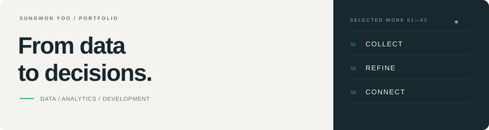
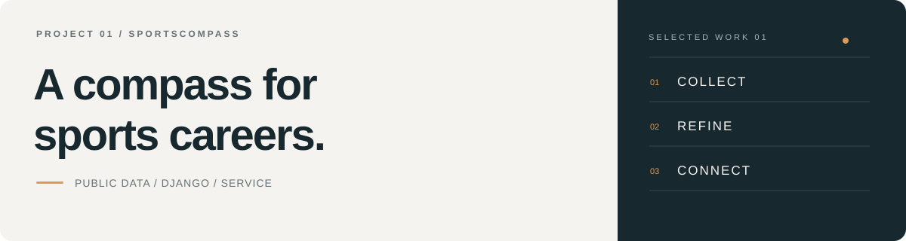
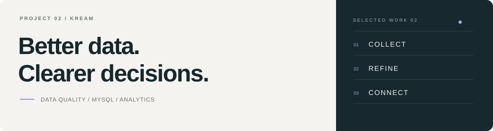

  

<h1 align="center">유성원 · Portfolio</h1>

  데이터를 정리하고, 근거를 찾고, 서비스로 연결합니다. 
  프로젝트에서 마주한 문제와 해결 과정을 기록합니다.

  <a href="#프로젝트">Projects</a> &nbsp;·&nbsp;
  <a href="#기술과관심">Skills</a> &nbsp;·&nbsp;
  <a href="#기록">Notes</a> &nbsp;·&nbsp;
  <a href="https://github.com/ericsw2727">GitHub ↗</a>

 

## 프로젝트

<table>
<tr>
<td width="50%" valign="top">

<h3>나침 · SportsCompass</h3>

공공데이터를 활용해 자격 준비와 스포츠 활동 기회를 연결한 커리어 플랫폼.

<strong>공공데이터 정제 · 분석 · 문서/UI 개선</strong>

<code>Python</code> <code>Django</code> <code>SQL</code>

<a href="projects/sportscompass/README.md"><strong>프로젝트 보기 →</strong></a> &nbsp; <a href="https://github.com/ericsw2727/MLO_1st_project_SportsCompass">Code ↗</a>

</td>
<td width="50%" valign="top">

<h3>KREAM · AI Ready Data</h3>

레거시 검수 기록을 표준화하고 운영 개선의 근거로 연결한 분석 프로젝트.

<strong>데이터 표준화 · 정합성 검증 · 운영 분석</strong>

<code>MySQL</code> <code>Pandas</code> <code>Matplotlib</code>

<a href="projects/kream/README.md"><strong>프로젝트 보기 →</strong></a> &nbsp; <a href="https://github.com/ericsw2727/MLO_2nd_project_KREAM">Code ↗</a>

</td>
</tr>
</table>

 

## 기술과 관심

| 분야 | 프로젝트에서 사용한 기술 |
|---|---|
| 데이터 처리·분석 | Python · SQL · Pandas · Matplotlib |
| 데이터 저장·검증 | MySQL · SQLite · PostgreSQL |
| 웹 서비스 | Django · HTML · CSS · JavaScript |

**학습 중** &nbsp; Spark · Kafka · MongoDB

 

## 기록

[작업 기록](devlogs/README.md) &nbsp; / &nbsp; [문제 해결](troubleshooting/README.md) &nbsp; / &nbsp; [학습 노트](learning/README.md) &nbsp; / &nbsp; [기록 양식](templates/README.md)

무엇을 했는지와 함께, 왜 그렇게 했는지와 어떻게 확인했는지를 남깁니다.

---

팀 프로젝트의 결과와 개인 기여를 구분하고, 수치의 기준과 근거를 함께 기록합니다.
