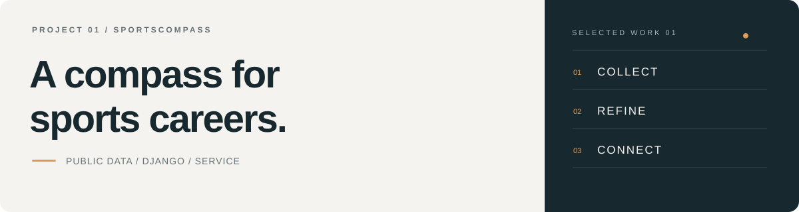
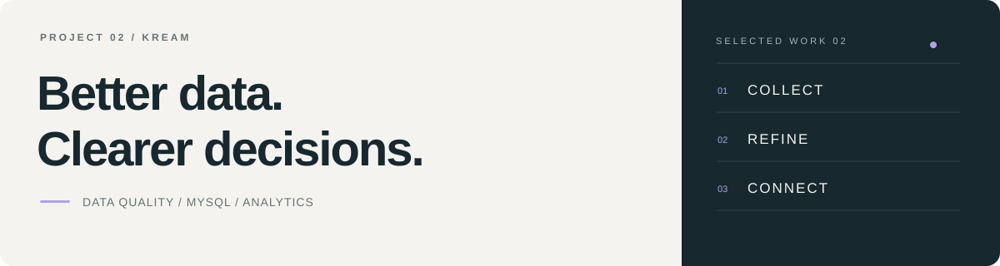

<a href="../README.md">← Portfolio</a>

# Selected projects

데이터를 서비스와 의사결정으로 연결한 두 가지 프로젝트.

 

### 01 &nbsp; 나침 · SportsCompass

공공데이터 정제와 분석을 스포츠 커리어 서비스에 연결했습니다.

`Python` `Django` `SQL` &nbsp; [프로젝트 보기 →](sportscompass/README.md)

 

### 02 &nbsp; KREAM · AI Ready Data

레거시 검수 기록을 표준화하고 검증 가능한 운영 분석으로 확장했습니다.

`MySQL` `Pandas` `Matplotlib` &nbsp; [프로젝트 보기 →](kream/README.md)

---

새 기록은 [프로젝트 양식](../templates/project.md)을 기준으로 추가합니다.
