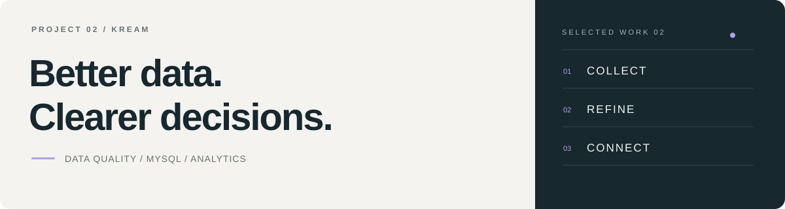

[← Portfolio](../../README.md) &nbsp; / &nbsp; Project 02

  

# KREAM · AI Ready Data

**레거시 검수 기록을 표준화하고, 운영 개선의 근거로 연결합니다.**

`MySQL` `SQL` `Python` `Pandas` `Matplotlib`

[소스 코드 ↗](https://github.com/ericsw2727/MLO_2nd_project_KREAM) &nbsp; · &nbsp; [상세 기록](case-study.md) &nbsp; · &nbsp; [정제·검증](data-quality.md)

 

## 핵심 결과

| 원본 검수 기록 | 정상 Silver | 독립 검증 |
|---:|---:|---:|
| **335,000행** | **271,787건** | **482개 검사 · 실패 0** |

2026-10-15 저장소 검증 기록. KREAM 스타일의 합성 데이터로 수행한 팀 프로젝트이며, 실제 기업의 운영 실적이 아닙니다.

 

## 무엇을 해결했나

중복·개정 충돌·형식 혼용·잘못된 마스터 연결이 함께 섞인 검수 기록을 분석 가능한 데이터로 바꿨습니다. 정상 결과를 만드는 것과 함께, **원본 행이 어디로 분류됐고 어떤 규칙이 적용됐는지** 추적하는 데 초점을 맞췄습니다.

| 단계 | 핵심 작업 |
|---|---|
| 진단 | 원본의 결측·중복·형식·참조·개정 충돌 프로파일링 |
| 표준화 | 단어·용어·도메인·코드 사전과 TO-BE 모델 정의 |
| 정제 | MySQL의 Bronze·Silver·Gold 테이블, 격리·보관 이력 구성 |
| 검증 | SQL 품질 검사와 Pandas 독립 검산, 원본 행 대사 |
| 활용 | 부서별 위험·재검수 부담·품목 배정과 작업량 분석 |

 

## 중요했던 세 가지 설계

**01 &nbsp; 오류 격리와 이력 보관을 분리**

오류 33,854행은 격리하고, 동일 중복·이전 유효 개정 29,359행은 별도 보관했습니다. 정상·격리·보관 합계를 원본 335,000행과 대사했습니다.

**02 &nbsp; 가장 큰 개정보다 최고 유효 개정**

최신 개정에 오류가 있으면 격리한 뒤 유효한 개정을 선택했습니다. 동일 개정의 내용이 충돌하면 임의 선택 없이 양쪽 모두 격리했습니다.

**03 &nbsp; 현재 상태와 실제 작업량을 구분**

최종 상태 271,787건과 이전 유효 개정을 포함한 작업 이력 291,548건을 나눠 재검수 작업량의 누락을 방지했습니다.

[정제 규칙과 검증 근거 자세히 보기 →](data-quality.md)

 

## 데이터에서 운영 제안으로

| 분석 주제 | 관측과 제안 |
|---|---|
| 외주야간검수팀 | 짧은 검수시간 비중과 품질 위험 확인 → 체크리스트·추가 확인·표본 감사 |
| 스니커즈팀 | 재검수 물량과 최초 오판정 확인 건수 비교 → 담당자 분리 기록·독립 재검수 |
| 품목 배정 | 팀별로 유사한 상품 구성 관측 → 품목별 전문팀·독립 클레임 기능 시범 운영 |

부서별 비교의 기간·분모를 구분했습니다. 관측된 연관성을 원인으로 확정하거나, 재검수에서 확인된 최초 오판정을 재검수 자체의 오류로 해석하지 않았습니다.

[세 가지 분석과 전체 그래프 →](case-study.md)

 

## 검증과 재현

- **482개 검사에서 실패 0개** — 정상 Silver·Gold 18개 테이블·188개 컬럼 대상
- **업무 CSV 27개 일치** — 기존 결과와 재실행 결과의 바이트 단위 비교
- **미검증·기준 차이 공개** — SQL 품질 기록의 14 PASS·1 미검증·1 기준 차이 구분

[검증 기록](https://github.com/ericsw2727/MLO_2nd_project_KREAM/blob/ba2570024e9b8a2d0c107eed0d4b084934864a45/reports/pandas_verification_summary.json) &nbsp; · &nbsp; [재현 비교](https://github.com/ericsw2727/MLO_2nd_project_KREAM/blob/ba2570024e9b8a2d0c107eed0d4b084934864a45/evidence/export_comparison.json) &nbsp; · &nbsp; [실행 안내](https://github.com/ericsw2727/MLO_2nd_project_KREAM/blob/ba2570024e9b8a2d0c107eed0d4b084934864a45/docs/REPRODUCE.md)

 

## 프로젝트를 통해 정리한 관점

데이터 품질은 정상 행의 개수만으로 설명할 수 없습니다. **복구·격리의 이유, 현재 상태와 작업 이력의 차이, 분석 지표의 분모**까지 함께 남겨야 결과를 설명하고 다시 검증할 수 있습니다.

<strong>상세 모델·예측 결과·해석 범위</strong>

- [상세 기록](case-study.md)에 Gold 작업량 예측과 기술·산출물 목록을 보존했습니다.
- MySQL 테이블로 레이어를 구현했습니다.
- 이번 문서는 저장소의 기존 검증 기록을 정리했으며 파이프라인을 새로 실행하지 않았습니다.
- 개인별 상세 분담은 추가 확인 대상입니다. 팀 산출물을 개인 단독 성과로 표시하지 않습니다.
- 482개 검사 결과는 검증한 규칙 범위의 결과입니다. SQL 미검증 항목과 상대팀 기준 건수 차이는 [정제·검증 상세](data-quality.md)에 공개했습니다.

---

[← 이전 프로젝트: SportsCompass](../sportscompass/README.md) &nbsp; · &nbsp; [상세 기록](case-study.md) &nbsp; · &nbsp; [정제·검증](data-quality.md)
