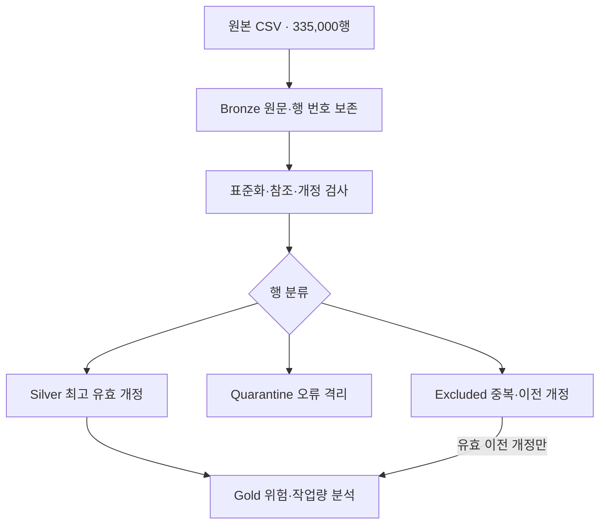

# 2차 프로젝트 | KREAM · AI Ready Data

**레거시 검수 기록을 표준화하고, 추적 가능한 데이터 모델과 운영 개선의 근거로 연결한 데이터 분석 프로젝트**

[프로젝트 저장소](https://github.com/ericsw2727/MLO_2nd_project_KREAM) · [정제·검증 상세](data-quality.md) · [팀 README](https://github.com/ericsw2727/MLO_2nd_project_KREAM/blob/ba2570024e9b8a2d0c107eed0d4b084934864a45/README.md)

## 프로젝트 개요

| 항목 | 내용 |
|---|---|
| 주제 | 레거시 데이터의 AI Ready Data 변환 및 표준 사전 구축 |
| 형태 | 팀 프로젝트 · KREAM 스타일의 합성 검수 데이터 분석 |
| 핵심 문제 | 중복·개정 충돌·표기 차이·단위 혼용·잘못된 마스터 연결로 집계가 왜곡되는 문제 |
| 처리 범위 | AS-IS 진단 → 표준 사전 → TO-BE 모델 → MySQL 정제·적재 → Pandas 검증 → Gold 분석 |
| 주요 기술 | MySQL·SQL, Python·Pandas, Matplotlib, MySQL Workbench |
| 결과 기준일 | 저장소 검증 기록 기준 2026-10-15 |

실제 KREAM의 운영 데이터나 공식 품질 지표를 분석한 자료는 아닙니다. 이 문서는 팀 저장소에서 확인한 결과를 중심으로 정리했으며, 개인별 상세 분담을 확인하기 전까지 전체 산출물을 개인 단독 성과로 표시하지 않습니다.

## 핵심 결과

| 원본 검수 기록 | 정상 Silver | 오류 격리 | 중복·이전 개정 보관 |
|---:|---:|---:|---:|
| 335,000행 | 271,787건 | 33,854행 | 29,359행 |

원본의 모든 행을 정상·격리·보관으로 대사하여 **335,000행과 일치**시켰습니다. 정상 최종 상태는 검수별 최고 유효 개정 한 건이며, 보관된 이전 유효 개정은 작업량 분석에서 별도로 활용합니다.

- Pandas 독립 검증: **18개 테이블·188개 컬럼, 482개 검사에서 실패 0개**
- 재현 결과 비교: CSV 29개 중 **업무 CSV 27개가 바이트 단위로 일치**
- 별도 SQL 품질 기록: **14개 PASS·1개 미검증·1개 기준 차이 기록**

검증 결과는 저장소의 기존 기록입니다. 이번 포트폴리오 정리에서 정제 파이프라인을 다시 실행한 것은 아니며, 482개 검사를 통과했다는 결과를 모든 업무 규칙의 검증 완료로 확대하지 않습니다.

## 데이터 처리 구조

Bronze·Silver·Gold는 **MySQL 테이블로 구현한 레이어 구조**입니다. Delta Lake나 Spark를 사용한 것으로 표기하지 않습니다.

## 중점적으로 다룬 문제

| 문제 | 처리 방식 | 이유 |
|---|---|---|
| ID·날짜·금액·소요시간 형식 혼용 | 표준 사전·단위·시간대 규칙 적용 | 같은 의미의 데이터를 같은 기준으로 비교 |
| 동일 검수·동일 개정의 내용 충돌 | 양쪽 기록 모두 격리 | 근거 없이 한 행을 정상 채택하지 않음 |
| 최신 개정에 오류가 있음 | 오류를 격리하고 최고 유효 개정 선택 | 단순 최대 개정 번호와 정상 현재 상태 구분 |
| 잘못 붙은 직원·부서 정보 | 사번으로 정상 마스터 재조인 | 이름·기존 결합 정보로 오류를 전파하지 않음 |
| 최종 상태와 실제 작업량 차이 | 유효 이전 개정을 작업 이력에 포함 | 재검수 작업량 누락 방지 |
| 정제 후 결과의 근거 부족 | 원본 행 번호·오류 플래그·수정 이력 보존 | 처리 결과를 원본까지 추적 |

세부 규칙과 원본 행 대사는 [정제·검증 상세](data-quality.md)에 정리했습니다.

## 운영 개선 분석

### 1. 외주야간검수팀의 검수시간과 품질 위험

일반 검수 **243,454건**을 대상으로 부서별 판정·검수시간·산식 배상액을 비교했습니다. 외주야간검수팀에서 가품 오판정 코드 633건, 10분 미만 검수 비중 93.65%가 관측됐습니다. 다른 부서 합산의 10분 미만 비중은 28.78%였습니다.

이를 점검 우선순위로 보고 **필수 체크리스트, 위험도별 추가 확인, 표본 감사**를 제안했습니다. 짧은 검수시간이 오류의 원인이라는 인과관계로 확정하지 않았습니다.

### 2. 스니커즈팀의 재검수 부담

2026년 10월 재검수 **21,656건**에서 스니커즈검수1·2팀의 물량과 최초 오판정 확인 건수를 비교했습니다. 재검수에서 발견한 최초 오판정과 재검수 자체의 오류를 구분하고, 물량과 비율을 함께 살폈습니다.

**최초 판정 연결, 실제 재검수 담당자 분리 기록, 반복 사유에 따른 교육과 독립 재검수 절차**를 제안했습니다. 재검수 표본의 발견 비율을 전체 상품의 가품 확률로 해석하지 않았습니다.

### 3. 품목별 배정 구조와 전문팀 구성

일반 검수에서 8개 팀 모두 정상 관측 상품 19종을 다루고 상품 구성비도 유사하게 나타났습니다. 이를 바탕으로 **품목별 전문팀과 독립 클레임 기능의 시범 운영**을 제안했습니다.

상품 배정 구조에 대한 관측이며, 여러 상품을 담당한다는 이유만으로 개인 전문성이 부족하다고 판단하지 않았습니다.

분석 기간·분모와 계산 근거: [운영 분석 상세](https://github.com/ericsw2727/MLO_2nd_project_KREAM/blob/ba2570024e9b8a2d0c107eed0d4b084934864a45/docs/ANALYSIS.md) · [재계산 기록](https://github.com/ericsw2727/MLO_2nd_project_KREAM/blob/ba2570024e9b8a2d0c107eed0d4b084934864a45/reports/team_analysis/verification.json)

## Gold 모델과 작업량 예측

최종 Silver 271,787건과 유효 작업 이력 **291,548건**을 구분했습니다. 유효 작업 이력에는 최초 검수 269,892건과 재검수 21,656건이 포함됩니다.

최근 28일 평균과 같은 요일 평균을 사용해 2026-09-01~09-07의 작업량을 평가했습니다. 입력은 2026-08-04~08-31이며, 완료·추출 시각을 모두 기준 시각 이내로 제한했습니다.

| 방법 | 건수 WAPE | 소요시간 WAPE |
|---|---:|---:|
| 최근 28일 평균 | 4.2690% | 7.1242% |
| 같은 요일 평균 | 4.1128% | 7.6594% |

이는 해당 7일 평가 구간의 결과입니다. 가용시간별 인력 계산은 시나리오이며, 실제 추가 채용 인원이나 개선 효과가 입증된 결과로 보지 않습니다.

## 사용 기술과 산출물

| 기술 | 활용 |
|---|---|
| MySQL·SQL | 레이어 테이블, 정제·적재, 재조인, 개정 분류, Gold 집계 |
| Python·Pandas | 원본 프로파일링, 독립 검산, 원본 추적, 분석 재계산 |
| Matplotlib | 정제 결과와 운영 위험·작업량 시각화 |
| CSV·JSON | 데이터 교환, 규칙·스키마·검증 근거 관리 |
| HTML·SVG | 표준 사전 보고서, 모델 명세, ERD |

| 산출물 | 근거 |
|---|---|
| AS-IS 프로파일링 | [진단 자료](https://github.com/ericsw2727/MLO_2nd_project_KREAM/tree/ba2570024e9b8a2d0c107eed0d4b084934864a45/reports/bronze) |
| AI 데이터 표준 사전 | [단어·용어·도메인·매핑](https://github.com/ericsw2727/MLO_2nd_project_KREAM/tree/ba2570024e9b8a2d0c107eed0d4b084934864a45/dictionaries) |
| TO-BE 모델·ERD | [모델 명세](https://github.com/ericsw2727/MLO_2nd_project_KREAM/blob/ba2570024e9b8a2d0c107eed0d4b084934864a45/docs/MODEL.md) |
| 재현용 정제 SQL | [sql/repro](https://github.com/ericsw2727/MLO_2nd_project_KREAM/tree/ba2570024e9b8a2d0c107eed0d4b084934864a45/sql/repro) |
| 정합성 검증 | [검증 설명](https://github.com/ericsw2727/MLO_2nd_project_KREAM/blob/ba2570024e9b8a2d0c107eed0d4b084934864a45/docs/VERIFICATION.md) · [Pandas 검증 기록](https://github.com/ericsw2727/MLO_2nd_project_KREAM/blob/ba2570024e9b8a2d0c107eed0d4b084934864a45/reports/pandas_verification_summary.json) |
| 운영 분석·시각화 | [분석 설명](https://github.com/ericsw2727/MLO_2nd_project_KREAM/blob/ba2570024e9b8a2d0c107eed0d4b084934864a45/docs/ANALYSIS.md) · [그래프 및 실행 코드](https://github.com/ericsw2727/MLO_2nd_project_KREAM/tree/ba2570024e9b8a2d0c107eed0d4b084934864a45/KREAM_Pandas_%EC%8B%9C%EA%B0%81%ED%99%94) |
| 재현 방법 | [실행 안내](https://github.com/ericsw2727/MLO_2nd_project_KREAM/blob/ba2570024e9b8a2d0c107eed0d4b084934864a45/docs/REPRODUCE.md) |

## 회고와 개선 방향

이 프로젝트의 핵심은 오염 값을 정상 형태로 바꾸는 것에 더해 **어떤 근거로 복구·격리했는지 설명하고, 결과를 원본과 대사할 수 있게 만드는 것**입니다. 분석에서는 최신 상태·유효 작업 이력·부서 등록 인원처럼 단위가 다른 지표를 구분해야 한다는 점도 중요했습니다.

향후에는 상대팀 기준과 현재 분류 차이를 규칙별로 설명하고, 미검증 점검 조건을 보완할 필요가 있습니다. 실제 담당자·당시 소속·근무표를 확보한 뒤 전문팀 배정과 독립 재검수 제안의 효과를 평가하는 것이 다음 과제입니다.

---

문서 기준: [소스 스냅샷 ba25700](https://github.com/ericsw2727/MLO_2nd_project_KREAM/commit/ba2570024e9b8a2d0c107eed0d4b084934864a45) · 정리일: 2026-11-04

[프로젝트 목록](../README.md) · [포트폴리오](../../README.md)
