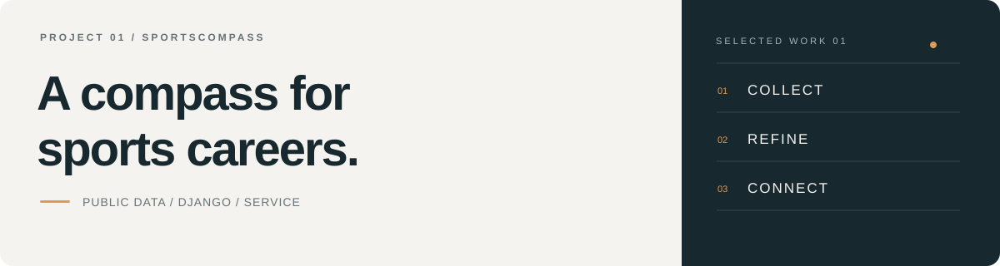

[← Portfolio](../../README.md) &nbsp; / &nbsp; Project 01

  

# 나침 · SportsCompass

**자격 준비부터 활동 기관·일자리 탐색까지, 스포츠 커리어의 다음 방향을 안내합니다.**

`Python` `Django` `Pandas` `SQLite` `PostgreSQL`

[소스 코드 ↗](https://github.com/ericsw2727/MLO_1st_project_SportsCompass) &nbsp; · &nbsp; [상세 기록](case-study.md) &nbsp; · &nbsp; [데이터 처리](data-processing.md)

 

## 한눈에 보기

| 형태 | 대상 | 나의 담당 |
|---|---|---|
| 3인 팀 프로젝트 | 지도자 준비생·현직 지도자·체육기관 | 공공데이터 정제 · 분석 기능 · 문서/UI 개선 |

분산된 자격·프로그램 정보를 한곳에서 비교할 수 있도록 종목과 지역의 기준을 맞추고, 정제한 데이터를 추천과 분석 화면에 연결한 프로젝트입니다.

 

## 내가 다룬 문제

### 01 &nbsp; 같은 의미, 다른 표기

지역명·종목명·프로그램명 표현이 달라 집계가 나뉘는 문제를 정리했습니다. 별칭과 부가 표현을 정규화하고 자격 데이터의 기준 종목에 연결했습니다.

> `서울특별시 → 서울` &nbsp; `성인수영 초급 월수금 → 수영`

[정규화 코드](https://github.com/ericsw2727/MLO_1st_project_SportsCompass/blob/c82193858d6144a326675aeee22b77fa48643f42/main/analytics/services/normalizers.py) · [프로그램 정리](https://github.com/ericsw2727/MLO_1st_project_SportsCompass/blob/c82193858d6144a326675aeee22b77fa48643f42/main/analytics/services/program_cleanup.py)

### 02 &nbsp; 전체 데이터와 분석 대상 구분

운영 종료·예정 프로그램, 날짜가 불완전한 항목, 복수 종목을 구분했습니다. 원본을 보존하면서 정제 결과와 적용 규칙·제외 근거를 별도로 남기는 구조를 사용했습니다.

[정제 기준과 경계 사례 →](data-processing.md)

### 03 &nbsp; 집계에서 해석으로

자격 취득·프로그램·기관 현황과 신청률을 비교하는 분석 기능을 다뤘습니다. 계산할 수 없는 신청률은 데이터 부족으로 구분하고, 지표가 의미하는 범위를 함께 설명했습니다.

[분석 서비스 코드](https://github.com/ericsw2727/MLO_1st_project_SportsCompass/blob/c82193858d6144a326675aeee22b77fa48643f42/main/analytics/services/analytics.py)

 

## 서비스 구성

| 탐색과 추천 | 분석과 활동 |
|---|---|
| 자격 방향·활동 기관 추천 | 지도자·프로그램·신청 현황 |
| 자격·시험 일정·AI 교재 추천 | 기관 지도·고용24·대타 모집 |
| 입력 조건과 추천 이유 안내 | 커뮤니티와 현장 정보 공유 |

팀 서비스 전체 범위입니다. 개인 담당 영역의 관련 코드가 파일 전체의 단독 구현을 의미하지는 않습니다.

 

## 데이터 규모

| 전체 프로그램 | 분석 가능 프로그램 | 기관 | 기준 종목 |
|---:|---:|---:|---:|
| **204,461** | **9,377** | **376** | **113** |

팀 README의 2026-09-29 로컬 스냅샷. 신청 현황의 시연용 합성 데이터는 실제 운영 실적과 구분합니다.

 

## 이 프로젝트에서 배운 것

수집과 적재만으로는 데이터가 바로 서비스에 쓰이지 않습니다. **같은 기준으로 정리하고, 어떤 데이터를 왜 제외했는지 설명하는 과정**이 분석의 신뢰도를 결정한다는 점을 배웠습니다.

다음 단계는 원천 데이터 갱신일·정제 버전 관리, 실제 신청 데이터 확보, 기능별 개인 기여 근거 보완입니다.

<strong>검증 범위와 현재 제약</strong>

- 저장소에는 원본 보존·복수 종목 제외·반복 정제 등을 확인하는 [테스트 코드](https://github.com/ericsw2727/MLO_1st_project_SportsCompass/blob/c82193858d6144a326675aeee22b77fa48643f42/main/analytics/tests/test_program_cleanup.py)가 있습니다.
- 이번 문서 정리는 코드 검토 기준이며, 서비스 실행과 테스트 통과 여부를 새로 확인하지 않았습니다.
- 자격 취득 건수는 현재 활동하는 지도자 수와 다르며, 프로그램 수와 신청률은 실제 채용 수요를 직접 입증하지 않습니다.
- 멘토링은 출시 예정 화면이고, 대타 지원의 실제 자격 확인은 모의 구현입니다.

---

[상세 기록](case-study.md) &nbsp; · &nbsp; [데이터 처리](data-processing.md) &nbsp; · &nbsp; [다음 프로젝트: KREAM →](../kream/README.md)
