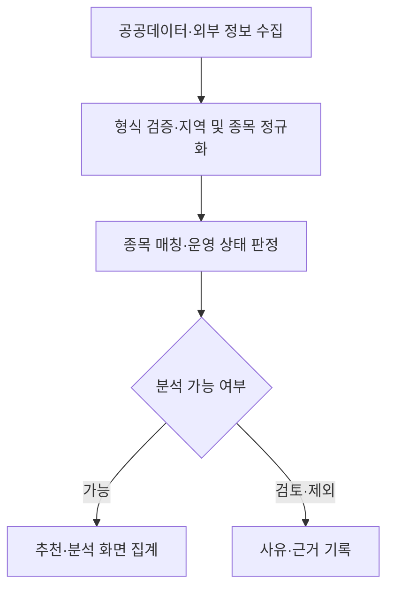

# 1차 프로젝트 | 나침 · SportsCompass

**분산된 체육 정보를 정제하고, 자격 준비부터 활동 기관·일자리 탐색까지 연결한 스포츠 커리어 플랫폼**

[소스 코드](https://github.com/ericsw2727/MLO_1st_project_SportsCompass) · [팀 프로젝트 README](https://github.com/ericsw2727/MLO_1st_project_SportsCompass/blob/c82193858d6144a326675aeee22b77fa48643f42/README.md) · [데이터 처리 상세](data-processing.md)

## 프로젝트 요약

| 항목 | 내용 |
|---|---|
| 형태 | 3인 팀 프로젝트 |
| 대상 | 체육지도자 준비생·현직 지도자·체육기관 담당자 |
| 핵심 문제 | 자격·프로그램·채용 정보가 분산되어 있고, 종목·지역 표기가 달라 비교하기 어려움 |
| 서비스 | 자격 방향 및 활동 기관 추천, 데이터 분석, 시험 정보, 일자리·대타 공고, 커뮤니티 |
| 나의 담당 | 공공데이터 정제, 분석 기능, 문서·UI 개선 |
| 핵심 경험 | 데이터 표준화 → 분석 대상 선별 → 집계·시각화로 이어지는 서비스 데이터 처리 |

개인 담당 범위는 팀 README의 역할 분담을 기준으로 정리했습니다. 아래 상세 코드는 담당 영역과 관련된 팀 구현 근거이며, 각 파일 전체를 개인 단독 구현으로 주장하지 않습니다.

## 내가 맡은 부분

| 담당 영역 | 정리 내용 | 관련 구현 |
|---|---|---|
| 공공데이터 정제 | 지역·종목 표현 통일, 프로그램명 정리, 분석 가능 여부와 제외 사유 구분 | [정규화](https://github.com/ericsw2727/MLO_1st_project_SportsCompass/blob/c82193858d6144a326675aeee22b77fa48643f42/main/analytics/services/normalizers.py), [프로그램 정리](https://github.com/ericsw2727/MLO_1st_project_SportsCompass/blob/c82193858d6144a326675aeee22b77fa48643f42/main/analytics/services/program_cleanup.py) |
| 분석 기능 | 자격 취득·프로그램·기관 집계와 신청률 계산, 종목별 현황 비교 | [분석 서비스](https://github.com/ericsw2727/MLO_1st_project_SportsCompass/blob/c82193858d6144a326675aeee22b77fa48643f42/main/analytics/services/analytics.py), [분석 화면](https://github.com/ericsw2727/MLO_1st_project_SportsCompass/blob/c82193858d6144a326675aeee22b77fa48643f42/main/analytics/views.py) |
| 문서·UI 개선 | 서비스 기능과 데이터 처리 기준을 문서화하고 분석 화면의 정보 전달 개선에 참여 | [팀 문서](https://github.com/ericsw2727/MLO_1st_project_SportsCompass/blob/c82193858d6144a326675aeee22b77fa48643f42/README.md), [분석 템플릿](https://github.com/ericsw2727/MLO_1st_project_SportsCompass/tree/c82193858d6144a326675aeee22b77fa48643f42/main/analytics/templates/analytics) |

## 해결하려던 문제와 접근

### 서로 다른 표기를 같은 기준으로 비교

공공데이터에는 지역과 종목이 서로 다른 표현으로 기록되어 있습니다. 지역명과 종목명을 정규화하고, 프로그램의 세부 표현을 자격 데이터의 기준 종목에 연결하여 집계 기준을 맞췄습니다.

예를 들어 `서울특별시 → 서울`, `성인수영 초급 월수금 → 수영`처럼 표현을 통일합니다. `풋살 → 축구` 같은 상위 종목 연결은 서비스의 분류 규칙이며, 두 종목의 자격이 동일하다는 의미는 아닙니다.

### 전체 프로그램과 실제 분석 대상을 구분

종료·예정 프로그램이나 여러 종목이 섞인 항목을 그대로 집계하면 현재 운영 현황이 왜곡될 수 있습니다. 기준일과 운영 상태, 종목 식별 가능 여부에 따라 분석 대상을 선별하고, 원본과 별도로 정제 결과·적용 규칙·제외 사유를 기록하는 구조를 사용했습니다.

### 숫자를 보여주는 데서 해석까지 연결

자격 취득 건수, 프로그램·기관 수, 정원·신청 인원 등을 집계하고 종목·지역별로 비교하는 분석 화면을 구성했습니다. 신청률을 계산할 수 없는 경우에는 0% 대신 데이터 부족으로 구분합니다. 자격 취득 건수는 현재 활동 중인 지도자 수와 구분하여 해석합니다.

구체적인 규칙과 경계 사례는 [데이터 처리 상세](data-processing.md)에 정리했습니다.

## 팀 서비스의 주요 기능

| 기능 | 제공 내용 |
|---|---|
| 맞춤 추천 | 자격 미보유자에게 자격 방향, 보유자에게 활동 기관과 추천 근거 제공 |
| 자격·시험 | 자격등급별 응시요건·과목·일정과 Gemini 기반 교재 추천 |
| 데이터 분석 | 지도자 자격 취득, 프로그램 운영, 신청 현황, 지역별 수요·공급 비교 |
| 기관 탐색 | 기관별 프로그램·활동 기회와 Kakao 지도 |
| 일자리·대타 | 고용24 채용공고 탐색과 단기 대타 공고·지원·관리 |
| 커뮤니티 | 게시글·댓글을 통한 시험 및 현장 정보 공유 |

멘토링은 출시 예정 화면이며, 대타 지원의 실제 자격 확인은 모의 구현 단계입니다.

## 사용 기술

| 영역 | 기술 | 프로젝트에서의 용도 |
|---|---|---|
| 데이터 처리 | Python, pandas, openpyxl, csv | 파일 처리, 검증 및 정규화 |
| 웹 서비스 | Django, Django ORM | 조회·집계 로직, 폼 및 화면 연동 |
| 화면 | Django Templates, HTML·CSS·JavaScript, Bootstrap, Chart.js | 사용자 화면과 데이터 시각화 |
| 저장소 | SQLite, PostgreSQL | 분석 데이터와 커뮤니티 등 서비스 데이터 분리 |
| 외부 연동 | requests, BeautifulSoup, Gemini, Kakao Maps | 수집, AI 교재 추천, 기관 위치 표시 |
| 운영·검증 | APScheduler, Gunicorn, WhiteNoise, Django TestCase | 정기 갱신, 서버·정적 파일 제공, 기능 검증 |

기술 목록은 팀 서비스 전체 기준입니다. 의존성은 [requirements.txt](https://github.com/ericsw2727/MLO_1st_project_SportsCompass/blob/c82193858d6144a326675aeee22b77fa48643f42/main/requirements.txt)에서 확인할 수 있습니다.

## 데이터 처리 흐름

## 결과와 규모

아래 수치는 **팀 README의 2026-09-29 로컬 스냅샷 기록**입니다. 이번 문서 작성 중 DB를 재집계한 값이나 개인 단독 성과 수치가 아닙니다.

| 항목 | 기록된 규모 |
|---|---:|
| 기준 스포츠 종목 | 113개 |
| 자격 취득 집계 레코드 | 17,467건 |
| 기관 | 376개 |
| 전체 프로그램 | 204,461건 |
| 운영 중·분석 가능 프로그램 | 9,377건 |
| 운영 종료 프로그램 | 176,619건 |
| 운영 예정 프로그램 | 18,465건 |

자격 취득 집계 레코드 수는 취득 인원 합계와 다릅니다. 전체 프로그램과 각 상태의 합계 관계는 세부 분류를 추가 확인해야 하므로, 이 표를 상호 배타적인 전체 분할로 해석하지 않습니다. 신청 현황의 시연용 합성 데이터도 실제 운영 실적과 구분합니다.

## 검증 근거와 한계

저장소에는 원본 보존, 프로그램명 정리, 복수 종목 제외, 운영 상태 판정, 반복 정제 시 중복 방지 등을 확인하는 [정제 테스트](https://github.com/ericsw2727/MLO_1st_project_SportsCompass/blob/c82193858d6144a326675aeee22b77fa48643f42/main/analytics/tests/test_program_cleanup.py)가 있습니다. 이번 작업은 README와 코드 검토로 문서를 정리한 것이며, 서비스를 실행하거나 테스트 통과 여부를 새로 확인하지는 않았습니다.

실제 이용자 수, 응답 속도 개선율, 추천 정확도 등 측정 근거가 없는 성과 수치는 기재하지 않았습니다. 신청률과 프로그램·자격 건수는 탐색을 돕는 지표이며, 실제 채용 수요나 인력 부족을 직접 입증하지 않습니다.

## 배운 점과 다음 개선

자동 수집·적재 이후에도 데이터를 같은 기준으로 정제하고 가공해야 서비스에서 의미 있게 사용할 수 있다는 점을 배웠습니다. 정제 결과뿐 아니라 처리 이유와 제외 기준을 남기는 것이 분석 결과를 설명하는 데 중요했습니다.

다음에는 원천 데이터 갱신일과 정제 버전을 함께 관리하고, 실제 신청 데이터 확보 후 합성 데이터 기반 시연을 대체하고자 합니다. 개인 기여는 기능별 변경 이력과 화면 자료를 더해 구체화할 계획입니다.

---

기준 코드: [최종 스냅샷 c821938](https://github.com/ericsw2727/MLO_1st_project_SportsCompass/commit/c82193858d6144a326675aeee22b77fa48643f42) · 문서 정리일: 2026-11-04

[프로젝트 목록](../README.md) · [포트폴리오](../../README.md)
